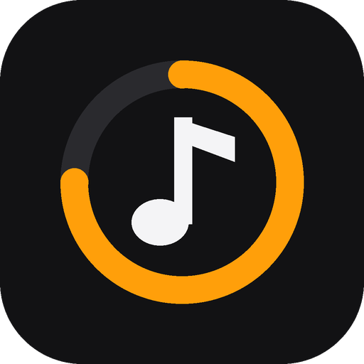
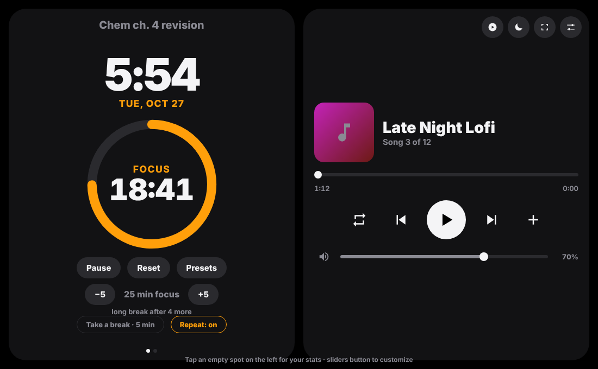

<h1 align="center">Study Max</h1>

A focus timer and music player for studying, inspired by Apple's StandBy mode. 
Big clock, Pomodoro timer, your music, and nothing else on the screen.

## Try it

**Website (any device, nothing to install):** https://studymax-focus.netlify.app

On iPhone or iPad, open it in Safari, tap **Share → Add to Home Screen**, and it runs full screen like a normal app. Turn your phone sideways for the StandBy look.

**Windows app:** download `StudyMax.exe` from the [Releases](../../releases) page and open it. It needs Microsoft Edge (already on every Windows 10/11 PC).

> Windows may say "Windows protected your PC" because the app isn't signed. Click **More info → Run anyway**.

## What it does

- **Clock and focus timer on one screen**, with a progress ring
- **Pomodoro loop:** focus, break, focus… with a **long break** after every 4 sessions
- **−5 / +5** buttons, a **Take a break** button, and **Repeat** on or off
- **Presets** you name yourself (like *Math 45/10* or *English 25/5*), each with its own color and focus noise
- **Stats:** time focused today, your streak, and a 7-day chart
- **Task line:** type what you're studying so it stays in front of you
- **Music**
  - Add your own songs (MP3 covers show up and are saved for next time)
  - **YouTube / YouTube Music links** (website): paste songs or playlists into a queue, rename them, skip, repeat
  - **Windows app:** picks up whatever YouTube Music, Spotify and so on are playing, with cover art and controls, automatically
- **Volume bar** with exact 1% steps
- **Mini mode:** a small always-on-top player
- **Customize:** accent colors (or match the album art), backgrounds, clock styles, 12/24-hour, red night mode
- **Notifications** when a timer ends

Everything you set up is saved on your own device. Nothing is sent anywhere.

## Good to know

- Private YouTube playlists (including **Liked Music**) can't play outside YouTube. Make a **Public** or **Unlisted** playlist instead.
- Some songs are blocked by their record label from playing outside YouTube. Study Max skips them in playlists.
- On iPad and iPhone, Apple doesn't let websites change YouTube's volume, so use the volume buttons for that.

## Build the Windows app yourself

You don't need to install anything; it uses the C# compiler that comes with Windows.

1. Download this repo (**Code → Download ZIP**) and unzip it.
2. Open the `windows-app` folder and double-click **Build StudyMax.bat**.
3. `StudyMax.exe` appears in that folder, and a **StudyMax** shortcut is added to your Desktop.

## Run the website yourself

The `website` folder is the whole site. Drag it onto [Netlify Drop](https://app.netlify.com/drop), or upload it to any static host.

## Files

| Folder | What's inside |
| --- | --- |
| `website/` | The site: `index.html`, app icons, and the home screen manifest |
| `windows-app/` | `StudyMax.cs` (the app), `standby.html` (its screen), the icon, and the build script |
